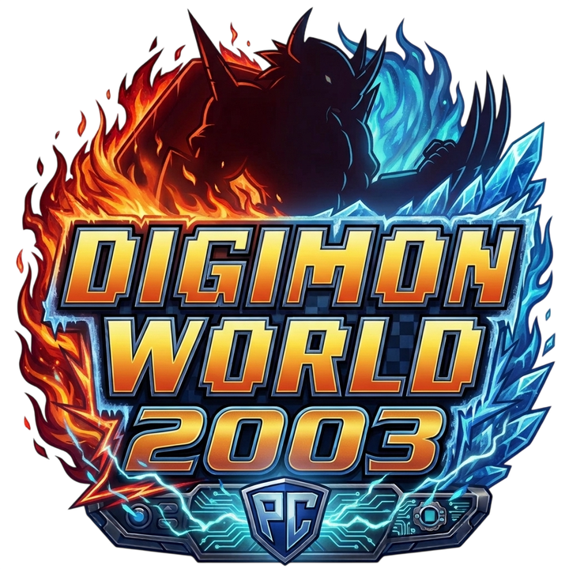

  

# Digimon World 2003: native PC port

The PlayStation game (Europe, SLES-03936) running natively on Windows, built from the
[dw3_decomp](https://github.com/ReGame-Labs/dw3_decomp) C code. It is not an emulator: the game's own code runs as a
PC program, with the console's hardware rewritten around it. It is free; donations are optional.

**Bring your own disc.** None of the game's content ships with the port: no graphics, sound, text or data tables. The
exe holds the game's logic as the decompiled C describes it, compiled anew; everything else comes from your own copy
of the game, read into a disc image.

## A native port, not a recompilation

There are two good ways to bring a PlayStation game to the PC, and both take a lot of work:

- **A static recompilation** translates the game's original MIPS machine code into C, instruction by instruction, and
  runs it next to an emulation of the console's hardware (GPU, sound chip, CD drive). It needs no understanding of
  the code, so it reaches the whole game quickly and plays it 1:1 from the start. It is the faster, safer road, and
  the projects that take it do real, valuable work.
- **A native port**, this one, starts from a *decompilation*: the game rewritten as readable, named C
  ([dw3_decomp](https://github.com/ReGame-Labs/dw3_decomp), someone else's work, without which this port wouldn't
  exist). That C is compiled by a modern compiler, and the console's hardware isn't emulated: the drawing,
  sound, files, pad and memory card are rewritten for the PC (OpenGL, SDL).

What the second road gives:

- **The game can be changed as source code**, not only as patched bytes: tables can grow, fields can be added (the
  [field editor](https://github.com/Feerdus95/dw3-field-editor) makes new ones), and fixes are written in C.
- **Files by name, of any size.** The game reads `data/files/NNNN.bin`, not sectors of a disc, so a mod's file can be
  bigger than the original.
- **Drawing made for the PC.** The 3D is drawn at up to 8 times the resolution with its exact points, and the battle
  models through a depth buffer, instead of the console's pixels scaled up.
- **Room to grow.** Nothing in it is tied to the MIPS processor, so other systems are within reach, and nothing of the
  game's content is in the exe.

The price is that every difference from the console has to be found and fixed by hand, which is why the port is
tested by playing it through.

## Requirements

- Windows 10 or 11.
- A graphics card with OpenGL 3.3 (any from the last decade).
- About 900 MB free: the game read from your disc goes next to the port.
- Your disc of *Digimon World 2003 (Europe) (En,Fr,De,Es,It)*, as an image. A `.cue`/`.bin` pair is best; an `.iso`
  may cause issues (a plain 2048-byte one loses the movies' sound).

### The disc it was tested with

| | |
|---|---|
| Title | Digimon World 2003 (Europe) (En,Fr,De,Es,It) |
| Serial | SLES-03936 |
| Track | 1 data track, MODE2/2352 |
| `.bin` size | 692,146,560 bytes |
| `.bin` CRC32 | `007df18e` |
| `.bin` MD5 | `da76a5685b875c353343102b7587fded` |
| `.bin` SHA-1 | `457cb233349ba841e03b33d8060f8fbcadd45cb3` |
| `SLES_039.36` CRC32 | `3334ed7a` |
| `SLES_039.36` SHA-1 | `d1b7e4d646e3a9c2b88fdb25d20b5f7116bbb06d` |

The port checks the game's executable inside the image (`SLES_039.36`), not the image itself: another good dump of
the same disc works even if its `.bin` hashes differ. The American (*Digimon World 3*) and Japanese versions are
different games for the port and are refused.

## Setup

1. Unzip the port anywhere you can write (a folder of your own, not `Program Files`).
2. Run `dw3launcher.exe` (or `dw2003.exe`, which opens it while there's no data). The first time, it asks for your disc
   image: drop the `.cue` (or `.bin`) on it, or click **Browse...**. It checks the version and reads the disc into
   `data/` next to the game, in a few seconds. It speaks English, Spanish, French, German and Italian (top right; it
   starts in your system's language).
3. From then on, the launcher's **Play** starts the game, and `dw2003.exe` starts it straight away. The image isn't
   needed any more.

The launcher's top bar has **Play** (with your team and the last save, read from the memory card), **Settings** (the
options below, before you start, with the controls' keys and buttons and a description of each mod), **Saves** (see
below), a notice when a newer port is out, and **Tools**: the
[model viewer](https://github.com/Feerdus95/dw3-model-viewer) and the
[field editor](https://github.com/Feerdus95/dw3-field-editor), downloaded from GitHub on request into a folder of their
own next to the port, set up to read `data/`, and opened from there. When a newer release of one is out, an **Update**
button beside its Open replaces its program files and leaves its settings and data alone. A viewer or editor already beside the port is used
instead of downloading. If `data/` was read by an older version, the viewer asks for the disc image once, for the
file names (`data/names.txt`).

The port's folder then holds:

| | |
|---|---|
| `dw2003.exe`, `SDL3.dll` | the port |
| `dw3launcher.exe`, `launcher.ini`, `launcher.log` | the launcher, its language and what it reports |
| `dw2003.fill` | where the game's own tables are in `data/`: the exe reads them from there at startup. Keep it next to the exe |
| `data/` | the game read from your disc. Yours: don't share it |
| `saves/card1.mcd` | your memory card |
| `saves/backups/` | the cards the launcher kept before an import or a restore |
| `native.ini` | your options, written by the options menu |

Saves go to `saves/card1.mcd`, a standard memory card image, created formatted on the first run. The launcher's **Saves**
page shows what each of the card's slots holds, and can **Export** the card (a backup, or to play on another computer),
**Import** one (a PlayStation or emulator `.mcd`: DuckStation, ePSXe...) and **Restore last copy**; every import or
restore first keeps the card you had in `saves/backups/`.

**Extra Digimon and your saves.** The game's slots stay as the original game writes them, so a card from the port loads
in the original game or an emulator. The Digimon the port adds beyond the game's 44 (BladeGarurumon and the Digimon mods) are
kept in a separate area of the card file, tied to the save they were made with, so the original game doesn't see them.
If a slot is saved again by the original game, an emulator or another card, those Digimon are left out of it (the
launcher marks it) and the port keeps a copy as `saves/card1.pre-stale.mcd` before its next save. Older versions of the port
don't see them either: copy your `saves/` folder before updating.

## Controls

| Keyboard | PlayStation |
|---|---|
| Arrows | D-pad |
| Z / Space | Cross |
| X | Circle |
| A | Square |
| S | Triangle |
| Q / W | L1 / R1 |
| E / R | L2 / R2 |
| Enter | Start |
| Backspace | Select |
| F11 or Alt+Enter | Fullscreen |
| F10 | Performance meter in fights (`perf = 1` starts it on); writes `perf/battle_<time>.csv` |
| Tab (gamepad: R3) | Fast forward: x2, x3, x5, off |
| Esc (gamepad: Back) | Options menu |

A gamepad works too (an Xbox pad or any SDL knows: A cross, B circle, X square, Y triangle, triggers L2 / R2, analog
sticks), with vibration. It can be plugged in or swapped while playing. Every button's keys (two each) and gamepad
button can be changed in the options menu's Input tab, **Controls**.

## Options

**Esc** (Back on a gamepad) opens the options menu; the game pauses while it is open, and what you change is saved to
`native.ini`. Its tabs, Display, Graphics, Input and Mods, turn with **L1 / R1** (Q / E or Page Up / Down):

| | |
|---|---|
| Frame rate | 50 (the European original) or 60 (the game's own 60 Hz mode; walking speed follows at the next area) |
| Resolution | the 3D drawn 1 to 8 times finer than the PlayStation's 320x240, on the graphics card |
| Sub-pixel 3D | the 3D's points at their exact place at higher resolutions, without the PlayStation's wobble |
| Depth buffer | the battle models' polygons in the right order at higher resolutions |
| Widescreen battles | battles in 16:9, the 3D seeing a third wider; the menus keep their shape at the edges, the HP panels and messages stretch, the fields stay 4:3. The window turns 16:9. Off by default |
| Perspective 3D | the 3D's textures in perspective, without the PlayStation's warping (with Sub-pixel 3D) |
| Smooth 3D textures | the 3D models' textures smoothed when enlarged, not in blocks; sprites and text stay sharp (with Sub-pixel 3D) |
| True colour | the colours at 8 bits a channel, without the PlayStation's 5-bit banding (dithering then has no use) |
| Dithering | the PlayStation's dithering on shaded polygons |
| Soft shadows | the shadows under the characters on the field darken the ground, with smooth edges, instead of the original's grey disc. Off by default |
| Battle shadows | the Digimon in battle cast their shape on the ground, as the light from above falls (with Sub-pixel 3D and the Depth buffer) |
| Battle sky and fog | battles get a sky behind the stage and their far side fades into a fog, each stage by its kind (open air, night, rooms, water) in `stages.ini` by the exe, which can be edited; digital, space and technique backdrops are left as they are |
| Smooth movies | the movies smoothed when scaled up, or with sharp pixels |
| VSync | each frame shown whole, at the screen's refresh: no tearing |
| Inactive window | what the game does while its window is not in front (minimised, or another window has the focus): nothing, mute the sound, or pause everything until it is back |
| Fullscreen, Window size | the window fits the screen it is on, centred |
| Controls | each PlayStation button's two keys and gamepad button: pick a slot, press the key or button (Esc / Back cancels); Del / Y clears it, the second to last line swaps Triangle (the game's cancel) and Circle, to cancel on B; the last puts the defaults back. A key or button set to one leaves any other it was on |
| Button icons | the menu's icons: PS1 (the game's own in its texts), PS3, PS4, PS5 (the default), Xbox 360, Xbox One, Xbox Series, Switch, Keyboard, or Auto (the keyboard or the gamepad you used last, by its maker). The game's texts show their buttons (✕ ○ □ △) the same way, as the key or button each is bound to. By [Xelu](https://thoseawesomeguys.com/prompts/) |
| Menus in fast forward | with fast forward on, a menu's cursor keeps its normal pace while a direction is held, instead of racing at x2, x3 or x5 |
| Menu cursor wraps | up from the first row goes to the last and down from the last to the first, in the field menu, the item lists, the shops and the techniques list; the other menus keep stopping at their ends |
| Skip PRESS START | the title screen shows New game / Continue at once, without waiting for Start (and without its ten seconds' timeout) |
| Vibration, Stick deadzone | the gamepad |
| Fast text | holding X advances the texts, outside battles and card games. After [Dmw2003FastText](https://github.com/markisha64/Dmw2003FastText), by markisha64 |
| Fast travel | on the map screen (the field menu's Map), X on a visited area asks, and Yes takes you there as the menu closes, through one of the game's own doors into it that is open at that point of the story. Once you have been to Amaterasu, Square switches between the two servers' maps. Off by default. After [Flawe's Mod](https://www.romhacking.net/hacks/9376/), by Flawe |
| Objective on map | the map screen blinks the area where the story's next step happens (visited or not); on the other server's map when the step is there. Off by default |
| Digilog | a last row of the field menu, DIGILOG: a journal in the item list's own panels, two tabs turned with left / right. Active: the story's current step and the side quests found (8 DDNA bosses, the old weapons, the dungeons' knights and masters, the Black Kings, the Undersea Base's two (while the story is there) and a few errands, each titled with its reward's name); Done: what is behind. Each with the place it happens at and what to do; L1 / R1 turn the pages, X shows the place on the map. Off by default |
| Fast forward | x2, x3 or x5 (Tab or R3 while playing); the music keeps its speed. Not saved |
| Extra starter packs | three more packs to pick in a new game: Dragon (Agumon, Guilmon, Veemon), Tactical (Kotemon, Monmon, Patamon), Mystic (Kumamon, Renamon, Veemon) |
| BladeGarurumon | a 45th Digimon every partner can learn, with Growlmon and Grizzmon at level 40: its own model (made at start from your disc's), techniques and signature, Solar Laser. Saves stay standard memory cards: its progress sits in the card file's spare space (see *Extra Digimon and your saves*), and an older save is carried over |
| Full EXP Share | every party partner still above 0 HP at battle end gets the full partner EXP, even if benched; its selected or used digivolutions get full Digimon EXP. Knocked-out partners get neither. Each partner gets the whole reward, not a share, so with three partners the party earns three times the EXP. Off by default |
| Heal on level up | a partner that levels up in a battle (not its Digimon) gets its HP and MP back in full, so grinding needs no trips to an inn |
| Save anywhere | a SAVE row in the field menu (before QUIT): save wherever you stand, not only at save points, and loading puts you back in the same spot. It uses the game's own memory card screen and the same save format, so the save also loads with the option off. |
| Custom effects | on by default: the battle effects' own images (`data/mods/effects/`, see below) play instead of the game's. Off plays the game's own; it switches in game, from the Mods tab, and shows at the next effect |
| Custom sounds | on by default: the sound an effect's `effect.json` gives (see below) plays instead of the game's hit sound (an effect without one keeps the game's), and so do the sounds of the sound library that replace one of the game's. It switches in game, from the Mods tab |
| Custom scripts | on by default: the battle scripts of `data/mods/scripts/` (see below) play instead of the game's for the fighters that have one. Off plays the game's own; it switches in game, from the Mods tab |

`native.ini` can also be written by hand (see `native.ini.example`); every line is optional:

    data = data          ; where the game read from your disc is (relative to the exe)
    fullscreen = 0       ; 1 to start in fullscreen
    scale = 4            ; window size in 320x240 steps (unset: the biggest that fits the screen)
    render_scale = 4     ; 1-8: the Resolution option (unset: as the window, up to 4)
    fps = 50             ; 60: the game's own 60 Hz mode
    widescreen = 0       ; 1: battles in 16:9 (the window too)
    perspective = 1      ; 0: the 3D's textures warp as on the PlayStation
    smooth_3d = 1        ; 0: the 3D's textures in sharp blocks
    true_color = 1       ; 0: the colours at the PlayStation's 5 bits a channel
    dither = 1           ; 0 turns off the PlayStation's dithering
    battle_shadows = 1   ; 0: no shadows in battle
    battle_sky = 0       ; 1: a sky behind battles, the stage's far side fading into it
    soft_shadows = 0     ; 1: the field's shadows see-through and smooth
    vsync = 1            ; 0: frames shown at once, which can tear
    smooth_movies = 1    ; 0 shows the movies with sharp pixels
    deadzone = 3277      ; how far the sticks and triggers move before they count (0-32767)
    rumble = 1           ; 0: no vibration
    fast_text = 1        ; 0: holding X doesn't advance the texts
    fast_travel = 0      ; 1: X on the map screen travels to the area
    map_objective = 0    ; 1: the map screen blinks the story's next area
    journal = 0          ; 1: the field menu's journal row
    extra_packs = 1      ; 0: only the game's three starter packs
    bladegarurumon = 1   ; 0: partners don't learn BladeGarurumon
    full_exp_share = 0   ; 1: full EXP and Digimon EXP for non-KO party members
    save_anywhere = 0    ; 1: a SAVE row in the field menu, to save anywhere
    custom_effects = 1   ; 0: the game's own effect images, not data/mods/effects'
    custom_sounds = 1    ; 0: no effect sounds from data/mods/effects
                         ; F12 in game saves the picture to screenshots/ by the exe
    debug = 0            ; 1: F1 debug stage select, F3 sound test, F4 vibration test, F2 dump of the game state,
                         ;    F5 / F9 save / load a state (saves/quick.state)
    log =                ; console logs: cd, snd, pad, mc, ovl, gpu or all

### Effects' own images (mods)

**Digimon mods.** Any folder `data/mods/digimon/<name>/` with a `digimon.json` adds one more Digimon partners can digivolve into, with no
change to the port (up to 4 at once). The mod is on while its model, the file `data/mods/<fid>.bin`, is there and `"enabled"` isn't `false` or 0;
the launcher and `native.ini` have no switch for it. The model and the manifest come from a converter (the model viewer's DW2 tab, or
`dw2-extractor/flame_dcb.py`, which makes Flamedramon's from your own Digimon World 2 and Digital Card Battle discs), or you write them.
The manifest is JSON (numbers, strings, `true`/`false` and lists). Every manifest is checked when the game starts: one that would make
the game read what isn't there, or holds a number its field can't take, is left out and the reason is written to the log
(`digimon mod <folder>: rejected, ...`); what is only unusual loads with a `warning`. Two mods that want the same id, the same fusion pair
or the same effect id are all left out (none wins by the order of the folders). Add `"schema_version": 1` (what a manifest without one is) and, for
whoever shares it, `"author"` and `"version"`:

- `id` (472, 473, ...: one a mod, it is how a save knows the form), `name` (ASCII), `fid`, `subs` [skeleton, motions, effects], `like` (a
  model whose record gives it cameras and face: 259, ExVeemon), `template` (a Digimon of the game it starts from, 40: MetalGarurumon).
- `hp_permille`, `mp_permille`, `stats` [strength, defense, spirit, wisdom, speed], `resists` [fire, water, ice, wind, thunder, machine, dark],
  `status`, `learn` (the six levels it learns techniques), `known`, `needs` [Digimon, level, Digimon, level]: what a partner needs to learn it.
- `techs`: six of `{name, help {en, fr, it, de, es}, from, mp, power, element_power, element, script}`; `from` is a technique of the
  game whose sprites and sounds it takes. `signatures`: how many of the last skills are signatures.
- Optional: `pair` (`{ids [a, b], element, element_power, shift, scripts [3], motions [3]}`: a pair that fuses into it in the Tag menu),
  `effects` (`[[effect id, fid], ...]` models of its techniques), `tired`, `portrait_dz`, `face`.

A battle's 2D effect can be drawn from your own PNGs: put them in `data/mods/effects/<id>/`. Each is the 320x240
screen around the effect's point, as the model viewer's Export PNGs saves an effect, or a bigger image of the same
shape for finer detail; their alpha blends them over the battle. A critical hit's go in `critical/` inside that folder
(without it, criticals use the others). A Digimon level's go in `rookie/`, `champion/`, `ultimate/` or `mega/` inside
it, each with its own `effect.json` and `critical/`, and `data/mods/effects/stages.json` says which partner is what:

    {"rookie": [3, 145], "champion": [5, 259], "ultimate": [12], "mega": [213]}

A partner plays its level's images, else the nearest lower level's, else the base ones, else the original; one the file
doesn't list, and every enemy, plays the base ones. In each folder a critical hit plays its `critical/`, else the plain
images. `"active": 0` in an `effect.json` leaves that folder out. An effect.json can also give the folder a sound,
played when the effect starts, in place of the game's hit sound of that attack (a folder with only this needs no PNGs):

    {"sound": {"file": "hit.wav", "volume": 1}}

`file` is a WAV of the folder (any rate or channels; up to 10 s) and `volume` goes from 0 to 4. The Mods tab's Custom effects
and Custom sounds switch the images and the sounds while the game runs. The folders are read when the game starts. Effect 2 is
the Fight command's hit. The ids are the model viewer's Effects tab's, which also does all of this for you: it imports the
PNGs, plays them, sets the levels and writes the folder's `effect.json`:

    {"frames": [["00.png", 2], ["01.png", 3]], "x": 0, "y": 0, "scale": 1, "blend": "alpha"}

**The sound library.** `data/mods/sounds/sounds.json` names WAVs of its folder and says which of the game's battle sounds each
replaces (the numbers the model viewer's Effects tab shows beside "Original"), wherever the game plays them:

    {"sounds": {"punch": {"file": "punch.wav", "volume": 1}}, "replace": {"57": "punch"}}

A name is 1 to 32 of `a-z 0-9 _ -`, a file a plain file name of the folder, the volume 0 to 4, a replaced number 1 to 89. A
sound the game has no number for, a name that isn't in the library or a WAV that can't be read leaves the game's own sound (the log
says why). It is read when the game starts, each WAV when it first plays, and Custom sounds switches it while the game runs.

**Script mods.** `data/mods/scripts/<fighter>/<script>.json` is the whole battle script of one fighter (the fighter's number and the
script's position in its archive, as the model viewer's Fighter tab shows them: 5 is the basic attack, 2 a hit reaction, 3 a KO):

    {"schema_version": 1, "commands": [
      {"op": "model", "who": "own", "do": "motion", "n": 3},
      {"op": "sound", "sound": "punch", "time": 0, "hit": true},
      {"op": "effect", "mode": "play", "effect": 2, "at": [0, -384, 5120]},
      {"op": "wait", "ticks": 10},
      {"op": "end"}]}

The commands are `hit`, `model`, `effect`, `stage`, `camera`, `effect_model`, `flash`, `sound`, `wait`, `end` and `raw` (one command's
words, for anything else); `docs/script-and-sound-mods.md` lists their fields. A sound is a name of the sound library, a game sound's
number (1 to 89) or `"hit"` / `"hit_last"` (the technique's hit sound); `"hit": true` makes a hit of result 3 play the game's own sound
instead. The numbers a command carries are the words the game stores, as the viewer lists them. A file with anything wrong in it is
rejected as a whole and the game's script plays (`dw2003.exe --check-mods` and the log say why). The folders are read when the game
starts, and Custom scripts switches them while the game runs.

Each frame is a PNG and its ticks. The battle counts time in ticks of 1/60 s (on PAL too), so an effect lasts its
ticks / 60 seconds; the original hit is 11 ticks, 0.18 s. `x`, `y` move the images in screen pixels, `scale` sizes
them, and `blend` is `alpha` or `add` (added, for glows). Without the file, the PNGs play in their names' order, 2
ticks each (30 a second).

## Troubleshooting

- **"The game's data doesn't match this version of the port"**: `data/` was read with another version of the port, or
  got damaged. Delete `data/` and start the game: it asks for the disc again.
- **"Can't write to the data folder"**: the port is somewhere Windows protects (`Program Files`, a read-only drive).
  Move the folder somewhere of your own.
- **No sound in the movies**: the disc was read from a plain `.iso`. Delete `data/` and read it again from a
  `.cue`/`.bin`.
- **The window doesn't open**: the graphics card needs OpenGL 3.3; update its driver.
- **It crashed**: `crash.txt` next to `dw2003.exe` says where. Please open an issue with it (the form asks for what
  helps), and a memory card from just before if you can. Never attach the game's files.

For scripts: `dw2003.exe --extract "path/to/image.cue"` reads the disc without the window, and the `DW3_DATA`
environment variable points the port at a `data/` elsewhere. `dw2003.exe --check-mods` lists what the loader makes of each
folder of `data/mods/digimon` (loaded, disabled, rejected and why, warnings) without opening the game; the exit code is
how many of the listed ones were rejected (the folders past the report's room are counted apart, not judged).
`dw2003.exe --render-sounds DIR [28,0x2A]` renders the game's own battle hit sounds (indexes of its battle sound table, a technique's
`scriptSound`; all of them without a list) to `DIR/<index>.wav` with the window hidden, in about three seconds. The launcher does it
once into `data/sounds` after it reads the disc (or when the folder is missing), for the model viewer's Original buttons.

## Building

For developers; players only need the release zip.

- [llvm-mingw](https://github.com/mstorsjo/llvm-mingw) (its `i686-w64-mingw32-clang`): set `LLVM_MINGW` to its folder,
  or put its `bin/` on the PATH.
- Python 3.10 or newer, and GNU `patch` on the PATH (Git for Windows has it).
- [dw3_decomp](https://github.com/ReGame-Labs/dw3_decomp) cloned **next to** this repository, at the commit in
  `DECOMP_COMMIT` (`build.py`):

      some-folder/
        dw3_decomp/      git checkout <DECOMP_COMMIT>
        native/          this repository (any name)

- SDL 3.4.16's MinGW development files (`SDL3-devel-3.4.16-mingw.zip` from the SDL releases), unzipped into
  `third_party/SDL3-3.4.16/`.

Then:

    python build.py                      # build/dw2003.exe (incremental; --clean for all)
    build/dw2003.exe --extract "path/to/Digimon World 2003 (Europe) (En,Fr,De,Es,It).cue"
    python build.py                      # again: now it takes the game's tables out of the exe
    python tools/package.py              # dist/dw2003-native.zip, refused if any of the game is in it

The first build has no `data/` yet, so its exe keeps the game's tables and can read the disc into `data/`; every build
after that takes them out (`tools/asset_scan.py`) and writes `dw2003.fill`. `python tools/smoke.py` builds and boots the
game unattended for 20 seconds; `python build.py --sanitize` builds with UBSan into `build-san/`.

`build.py` refuses a `dw3_decomp` that isn't at `DECOMP_COMMIT` (`--allow-decomp-mismatch` goes on anyway) and a PsyQ
stub that `tools/stubs.baseline` doesn't list (`--update-stub-baseline` rewrites the list); `build/report.md` says what
each build was made of. `python tools/run_tests.py` builds and runs the unit tests that need neither the game nor its
data (GitHub Actions runs it, and the self-tests, on every push).

## Credits

The port stands on [dw3_decomp](https://github.com/ReGame-Labs/dw3_decomp) (ReGame-Labs, juandav). Also:
[ddw3](https://github.com/markisha64/ddw3) (markisha64, Zenithsiz) for the game's text format;
[Dmw2003FastText](https://github.com/markisha64/Dmw2003FastText) (markisha64) and
[Flawe's Mod](https://www.romhacking.net/hacks/9376/) (Flawe) for the ideas of Fast text and Fast travel;
[dw2_decomp](https://github.com/Wyrelade/Digimon-World-2-Decomp) (Wyrelade) and
[dcb_decomp](https://github.com/ReGame-Labs/dcb_decomp) (ReGame-Labs) for Flamedramon's model and attacks;
[SDL 3](https://libsdl.org), [Xelu's prompts](https://thoseawesomeguys.com/prompts/) for the button icons,
[psx-spx](https://psx-spx.consoledev.net) for the hardware, and the Pixel Digivolve font (Pixel Sagas) in the launcher.
What each one gave, with its license, is in [`CREDITS.md`](CREDITS.md).

## Legal

© 2026 Feerdus. The port's own code is under the MIT License (`LICENSE`); what it builds on, and their licenses, is in
`CREDITS.md`.

A fan project, not affiliated with or endorsed by Bandai Namco. Digimon World 2003 is © Bandai / Bandai Namco; Digimon
is © Akiyoshi Hongo, Toei Animation. The port carries nothing of the game: everything comes from the disc you own.

---

## En español

Port nativo para PC de Digimon World 2003 (Europa, SLES-03936), compilado desde el C de
[dw3_decomp](https://github.com/ReGame-Labs/dw3_decomp). No es un emulador: el código del juego corre como un programa de
PC. Es gratis; las donaciones son opcionales.

**Necesitas tu propio disco.** El port no trae contenido del juego: ni gráficos, ni sonido, ni textos, ni tablas. El
exe tiene la lógica del juego tal como la describe el C descompilado, compilada de nuevo; todo lo demás sale de tu
copia.

**Port nativo, no recompilación.** Una recompilación estática traduce el código máquina original del juego a C,
instrucción por instrucción, y lo corre junto a una emulación del hardware de la consola: llega antes a todo el juego y
lo reproduce 1:1, y es un trabajo valioso. Este port parte de una *descompilación* (dw3_decomp, trabajo ajeno sin el
que no existiría): el juego reescrito como C legible, compilado con un compilador moderno, y el hardware de la consola
reescrito para PC en vez de emulado. Eso permite cambiar el juego como código fuente (tablas que crecen, campos nuevos
con el editor), archivos de cualquier tamaño, 3D dibujado hasta 8 veces más fino y, a futuro, otros sistemas. El
precio: cada diferencia con la consola hay que encontrarla y corregirla a mano, por eso se prueba jugándolo entero.

**Requisitos:** Windows 10 u 11, una tarjeta gráfica con OpenGL 3.3, unos 900 MB libres y tu disco de *Digimon World
2003 (Europe) (En,Fr,De,Es,It)* como imagen: mejor `.cue`/`.bin`; una `.iso` puede dar problemas. El disco con el que se
probó y sus sumas (CRC32, MD5, SHA-1) están en la tabla de arriba. El port comprueba el ejecutable del juego
(`SLES_039.36`), no la imagen: otra copia buena del mismo disco sirve. Las versiones americana y japonesa no.

1. Descomprime el port en una carpeta tuya donde se pueda escribir (no en `Program Files`).
2. Ejecuta `dw3launcher.exe` (o `dw2003.exe`, que lo abre mientras no haya datos). La primera vez te pide la imagen:
   arrastra el `.cue` (o el `.bin`) o pulsa **Buscar...**. Comprueba la versión y lee el disco a `data/`, en pocos
   segundos. Está en español, inglés, francés, alemán e italiano (selector con banderas arriba a la derecha).
3. Desde entonces, **Jugar** en el launcher arranca el juego, y `dw2003.exe` lo arranca directamente. Deja `dw2003.fill`
   junto al `.exe`: el port lee de `data/` las tablas del juego al arrancar. El launcher también tiene Ajustes, Partidas
   y Herramientas (el visor de modelos y el editor de campo).

Las partidas se guardan en `saves/card1.mcd`, una imagen de memory card estándar (se crea formateada la primera vez):
sirven las de emuladores. La página **Partidas** del launcher exporta e importa la tarjeta y restaura la última copia,
guardando antes la que tenías en `saves/backups/`. Los Digimon extra que añade el port se guardan aparte, ligados a su
partida: el juego original no los ve, y las versiones antiguas del port tampoco (copia `saves/` antes de actualizar).
**Esc** abre el menú de opciones (se guarda en `native.ini`); F11 o Alt+Enter, pantalla completa. Controles y
opciones: arriba.

Si sale **"The game's data doesn't match..."**, borra `data/` y arranca el juego: vuelve a pedir el disco.

© 2026 Feerdus, licencia MIT. Proyecto de fans, sin relación con Bandai Namco. Digimon World 2003 es © Bandai /
Bandai Namco.

**Créditos.** Lo que usa el port y de quién (dw3_decomp, ddw3, markisha64, Flawe, dw2_decomp, dcb_decomp, SDL 3, Xelu...) está en
la sección [Credits](#credits) y en [`CREDITS.md`](CREDITS.md).
